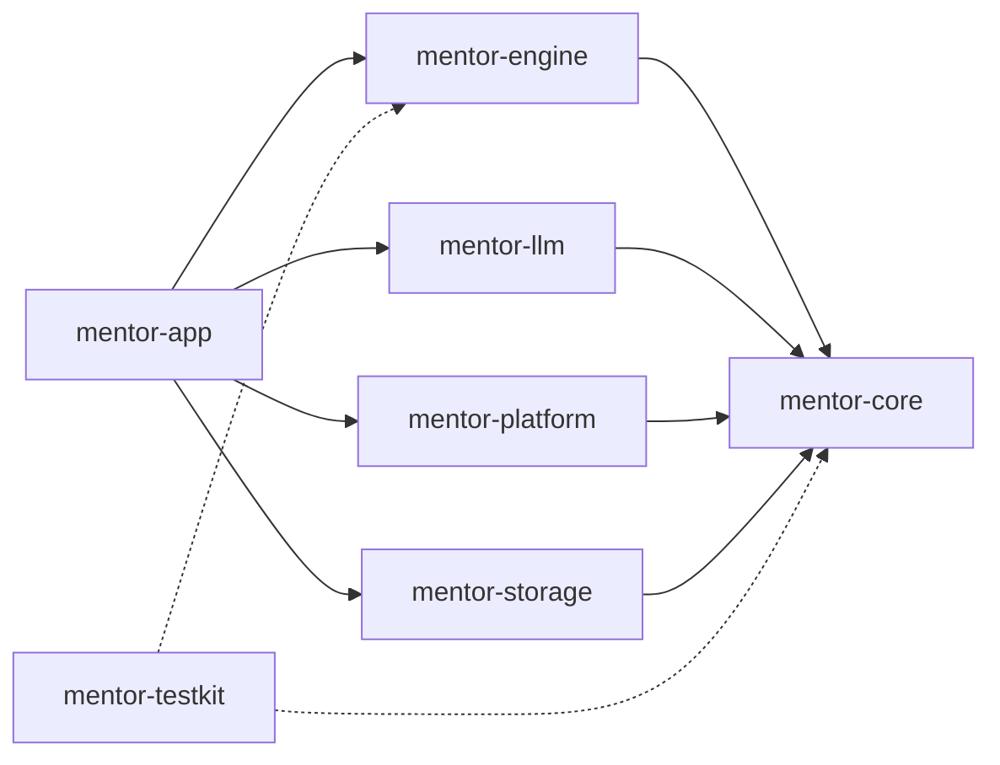
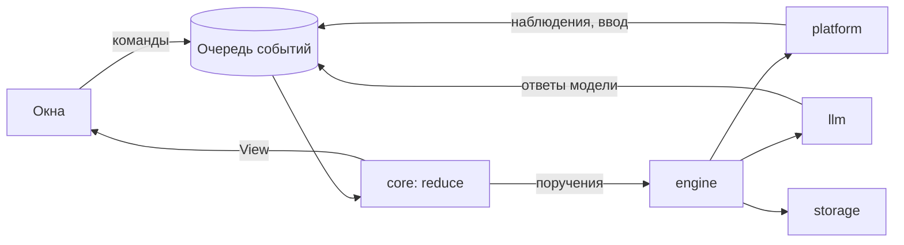

# Архитектура

Приложение делится на три части: ядро принимает решения, адаптеры общаются с внешним миром, а оболочка на Tauri собирает их вместе и показывает результат в окнах.

## Пакеты

| Пакет | Отвечает за | Зависит от |
|---|---|---|
| `mentor-core` | Типы задачи и шага, автомат сессии, поиск цели на экране, проверка условий, тексты подсказок, описание того, что показывают окна | — |
| `mentor-engine` | Очередь событий, исполнение поручений ядра, таймеры, отмена запросов | core |
| `mentor-llm` | Протоколы сервисов моделей, запросы по ролям, разбор структурированных ответов и ошибок | core |
| `mentor-platform` | Дерево элементов интерфейса, снимок экрана, мышь и клавиатура, мониторы | core |
| `mentor-storage` | Журнал сессии, настройки, недавние задачи, ключ доступа | core |
| `mentor-testkit` | Подставные адаптеры и проигрывание записанных сессий | core, engine |
| `mentor-app` | Окна, команды для интерфейса, трей, сборка адаптеров | engine, llm, platform, storage |



Правила зависимостей:

- `mentor-core` не зависит от асинхронной среды, сети, ОС, Tauri и системных часов.
- Адаптеры (`llm`, `platform`, `storage`) зависят только от ядра и не знают друг о друге.
- `mentor-testkit` подключается только в тестах.

## Сессия

Вся логика задачи выражена одной чистой функцией:

```rust
fn reduce(session: Session, event: Event) -> (Session, Vec<Effect>);
```

События приходят от человека (запрос, кнопка на карточке), от восприятия (наблюдение экрана, щелчок), от модели (готовый план, ответ на вопрос) и от системы (таймер, сон, пропавшая связь). Поручения ядра адресованы адаптерам: снять экран, спросить модель, записать в журнал, показать состояние окнам.



Что из этого следует:

- **Один владелец состояния.** Сессией владеет одна задача `engine`. Команды окон и адаптеры только кладут события в очередь, общего изменяемого состояния под блокировкой нет.
- **Долгие вызовы не останавливают очередь.** Запрос к модели или снимок экрана выполняется отдельной задачей и возвращается событием. У каждого запроса есть номер, по которому его можно отменить.
- **Устаревшие ответы отбрасываются в одном месте.** События от экрана и модели несут номер снимка, на котором они основаны. Ответ на уже изменившийся экран отбрасывает `reduce`.
- **Сбой является состоянием, а не исключением.** Пропавшая связь или занятый сервис переводят сессию в ожидание, которое видит человек. Ошибкой вызова остаётся только поломка самой программы.
- **Сессию можно проиграть.** Запись событий даёт то же состояние на любой машине, без модели и экрана. На этом построены тесты и восстановление задачи после перезапуска.

## Обмен с окнами

- **Окно → Rust.** Команды названы действиями человека: `start_task`, `card_button`, `stop_help`. Команда кладёт событие в очередь и сразу возвращается.
- **Rust → окно.** Ядро выдаёт `View`: готовое описание экрана с номером версии. Окно решает только, как его нарисовать. При открытии окно запрашивает текущий `View`, поэтому пропущенное событие ничего не ломает.
- Состояние задачи во фронте не хранится. Физические пиксели ОС в логические пиксели окон переводит только `mentor-app`.

## Окна

| Окно | Что показывает | Щелчки |
|---|---|---|
| `main` | Стартовый экран, настройки, установка | обычные |
| `island` | Короткий запрос над панелью задач | обычные |
| `overlay` | Затемнение, обводка цели, стрелка; по одному на монитор | проходят насквозь |
| `card` | Карточка шага | принимает, фокус не забирает |
| `plan` | План задачи | принимает, фокус не забирает |

Фронт собирается многостраничным: у каждого окна своя точка входа, поэтому прозрачный оверлей не загружает код настроек.
